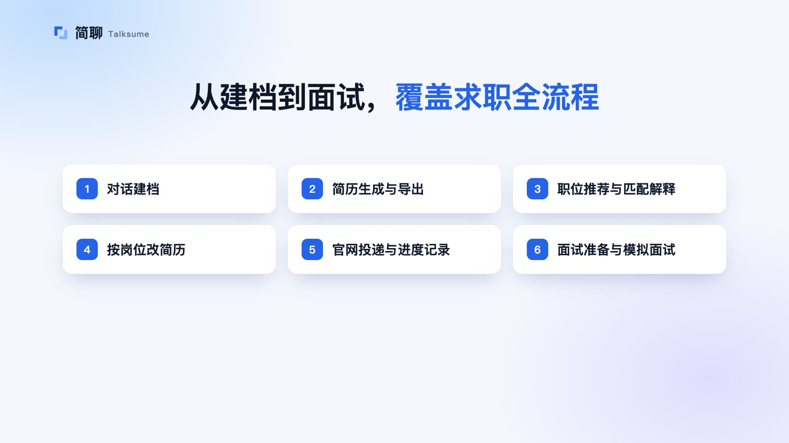
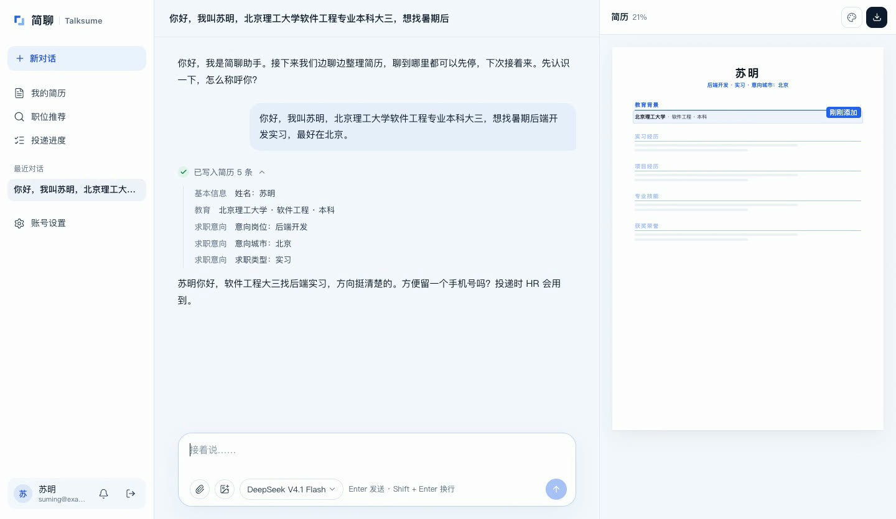
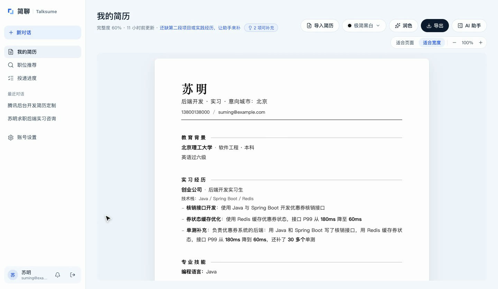
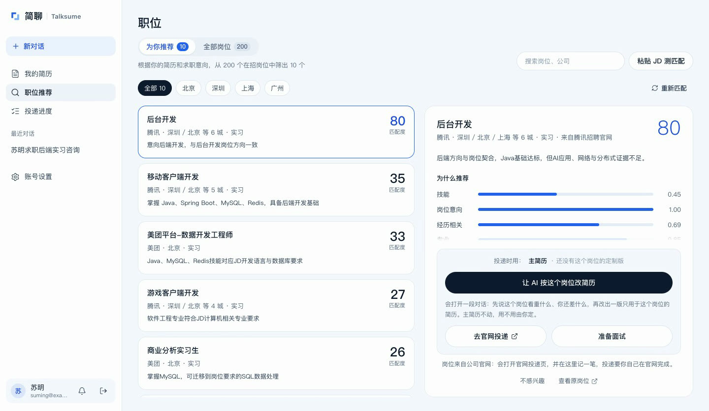
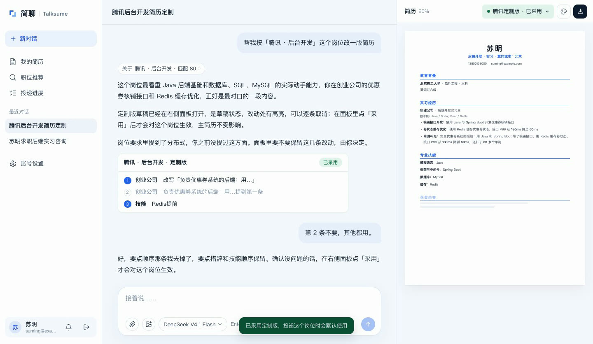
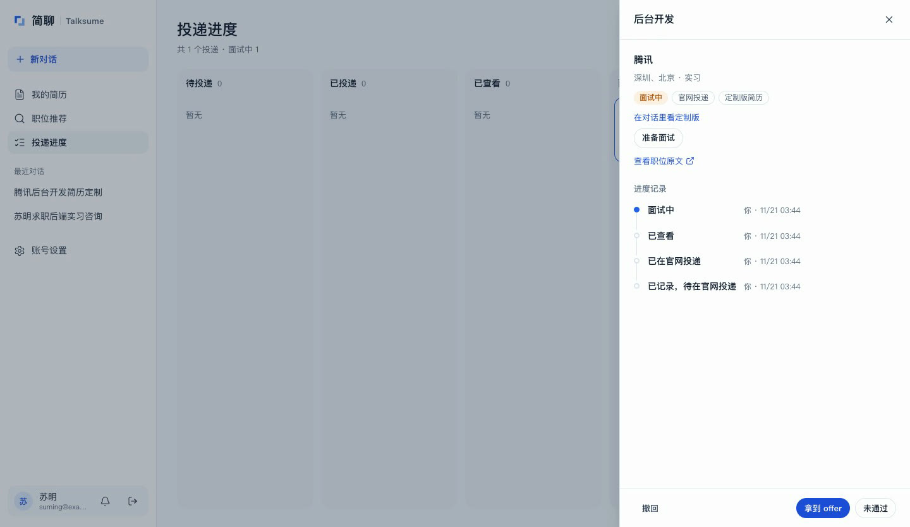
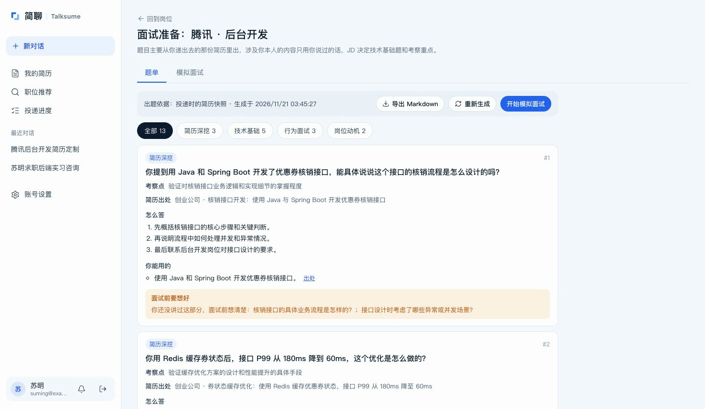
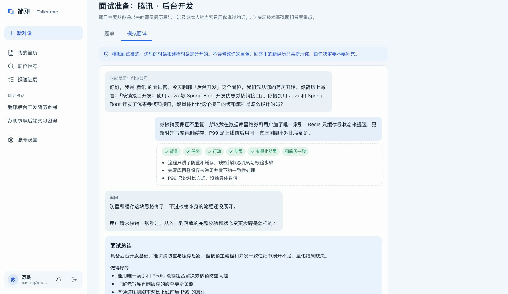
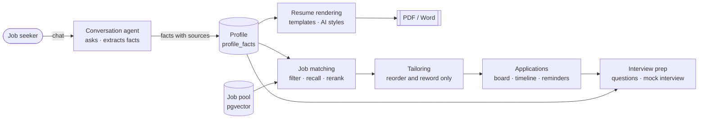

<div align="center">


# Talksume 简聊

[简体中文](README.md) · **English**

**Talk your way to a better resume, and to the right job.**

Build your resume through conversation, then get job recommendations, tailor the resume for each role, track your applications and prepare for interviews.




</div>

> The product UI is in Chinese. The screenshots below show a fictional user.

## Why Talksume

Resumes are hard at both ends. First you have to remember and put into words what you actually did. Then the same resume goes out to very different roles, and nobody tells you what each one cares about. Talksume handles both in a conversation: the assistant asks follow-up questions and takes notes while the resume takes shape on the right. When a role catches your eye, you adjust the resume for it in the same conversation.

The principle we care about most is **trustworthy facts**. Every line on the resume comes from something the user actually said, and keeps a link to the original words. The language model only asks questions and polishes wording; it cannot invent experience. When tailoring for a role, it can only reorder and reword what is already there, never add new facts.

## Features

| | |
|---|---|
| **Conversational profile building**<br>Introduce yourself as if chatting. The assistant asks about what is missing, and each extracted fact is written to the resume with a live preview. It handles off-topic replies and answers like "none", and asks for confirmation before writing anything you never said. You can also import an existing PDF or Word resume and fill in the gaps. |  |
| **Resume styles and export**<br>Several built-in templates and accent colors, plus AI-designed styles from a description or a reference image; each design is checked for overlapping text before it is saved. Export to PDF or Word, and polish individual bullet points in the chat. |  |
| **Job recommendations with explanations**<br>Jobs are filtered by hard constraints such as city and job type, recalled by keywords and semantic vectors, then scored by a reranking model. Every job shows a score breakdown, matched and missing skills, and the exact lines from the job description. Paste any job description to check the fit; marking a job "not interested" lowers similar jobs. |  |
| **Tailoring for a specific role**<br>Generate a tailored draft for the selected job. Each change comes with its reason and can be selected one by one before adopting, or adjusted in the chat ("drop change 2"). Adopting creates a tailored version; the main resume stays unchanged. |  |
| **Applying and tracking**<br>Open the employer's career site and apply there yourself, then record it in Talksume. A board groups applications by status, every status change is added to a timeline, and you are reminded to follow up when there is no reply for a while. |  |
| **Interview preparation**<br>Generate a question list from your resume and the target role. Each question includes what it tests, how to approach it, and talking points taken only from your own words, with their source in the resume. Export it as Markdown. |  |
| **Mock interviews**<br>The interviewer works through the question list, asks follow-ups and gives feedback on each answer, then ends with a summary and a list of improvements. |  |

## How it works



- **The profile is the single source of truth.** Facts confirmed in the conversation go into the profile first; the resume, matching, tailoring and interview questions are all generated from it, so everything traces back to the user's own words.
- **Resume versions are immutable.** Every change to content or style creates a snapshot, and each application records the version used, so what you sent is exactly what you saw.
- **Language model gateway.** A primary and a fallback model, with timeouts, idle timeouts and retries; personal information is redacted before requests. If no model is reachable, the chat shows a clear message instead of hanging.

## Tech stack

| Layer | Choice |
|---|---|
| Frontend | React 19, Vite, React Router, TanStack Query |
| Backend | Node.js (running TypeScript natively), Fastify 5, Zod |
| Agent | pi-agent-core with any OpenAI-compatible model; DeepSeek V4.1 Flash by default, GLM as fallback |
| Data | PostgreSQL 16 + pgvector (semantic vectors) + pg_trgm (fuzzy search), Drizzle ORM; Redis for notifications and rate limiting |
| Matching | Recall with embedding models such as bge-m3, rerank with models such as Qwen3-Reranker, and a rule engine for explainable scores |
| Resume rendering | HTML templates, Playwright (Chromium) for PDF, docx for Word |
| Deployment | Docker Compose: postgres, redis, server, web (nginx) |

## Getting started

### Deploy with Docker

You need Docker and an OpenAI-compatible language model API.

```bash
cp deploy/.env.example deploy/.env
# Edit deploy/.env: set at least POSTGRES_PASSWORD, LLM_BASE_URL and LLM_API_KEY
docker compose -f deploy/docker-compose.yml up -d --build
```

Then open `http://localhost:8000` and register an account. On first start the database schema is created and 200 seed jobs from public campus recruiting sites are loaded.

Common settings (see [`deploy/.env.example`](deploy/.env.example) for all of them):

| Variable | Purpose |
|---|---|
| `LLM_BASE_URL`, `LLM_API_KEY` | Language model API, required |
| `LLM_MODEL`, `LLM_FALLBACK_MODEL` | Primary and fallback model; defaults are used when empty |
| `EMBEDDING_BASE_URL`, `EMBEDDING_MODEL` | Embedding model; without it only keyword recall is used |
| `RERANK_BASE_URL`, `RERANK_MODEL` | Reranking model; without it semantic reranking is skipped |
| `AUTH_EMAIL_ENABLED` | Email verification and password reset, off by default; requires `APP_URL` and `SMTP_*` when on |
| `WEB_PORT` | Public port, 8000 by default |

### Local development

You need Node ≥ 22.19 (24 recommended), pnpm 12 and PostgreSQL 16 with pgvector.

```bash
pnpm install

# Create .env in the repository root with DATABASE_URL, LLM_BASE_URL and LLM_API_KEY
pnpm dev:server       # http://localhost:8080
pnpm dev:cloud-web    # http://localhost:5173, proxies /api to 8080
```

The server runs `.ts` files directly through Node's type stripping, with no build step, so the source may only use erasable TypeScript syntax (`erasableSyntaxOnly`).

Before committing:

```bash
pnpm lint && pnpm typecheck && pnpm test
```

## Project layout

```text
apps/web               Web frontend: chat, resume, jobs, applications, interview pages
packages/core          Domain model: profile, resume, application state machine, and port interfaces
packages/agent         Conversation agent: tools and prompts for profiling, tailoring, polishing, interviews
packages/server        Fastify app factory buildApp(deps), routes and business flows
packages/db            Drizzle schema and migrations
packages/matching      Job matching: filtering, recall, reranking, explanations, deduplication
packages/jobs-ingest   Job collection and field normalization
packages/resume-render Resume template rendering, PDF and Word export
packages/llm-gateway   Model gateway: fallback, timeouts, retries, redaction
cloud/                 Cloud edition: sign-up, sessions, email, rate limiting, server and web entry points
deploy/                Docker Compose, Dockerfiles, nginx config
data/seed              Seed jobs
```

`packages/*` and `apps/*` must not import from `cloud/`. `pnpm check:boundary` checks the imports, and `pnpm verify:open-build` removes `cloud/`, reinstalls dependencies, type-checks and runs the tests.
