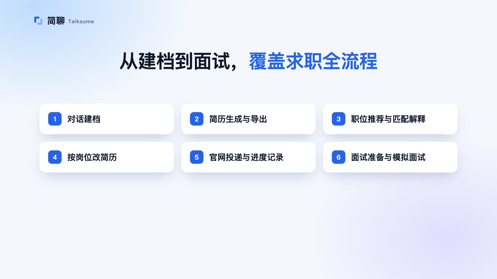
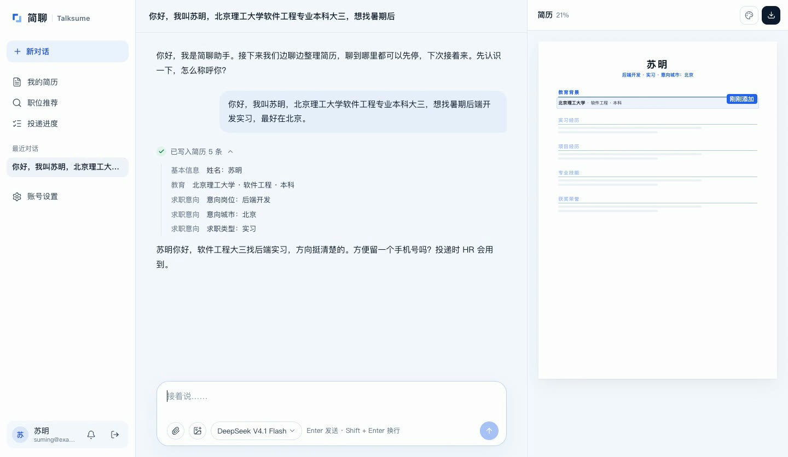
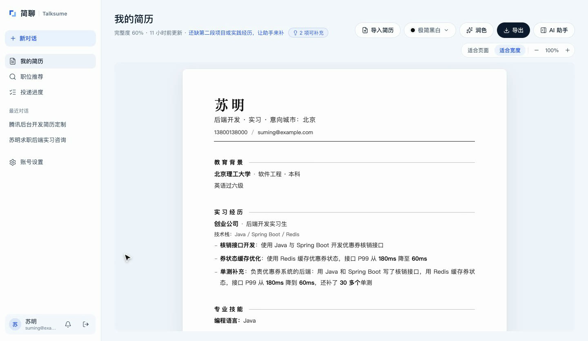
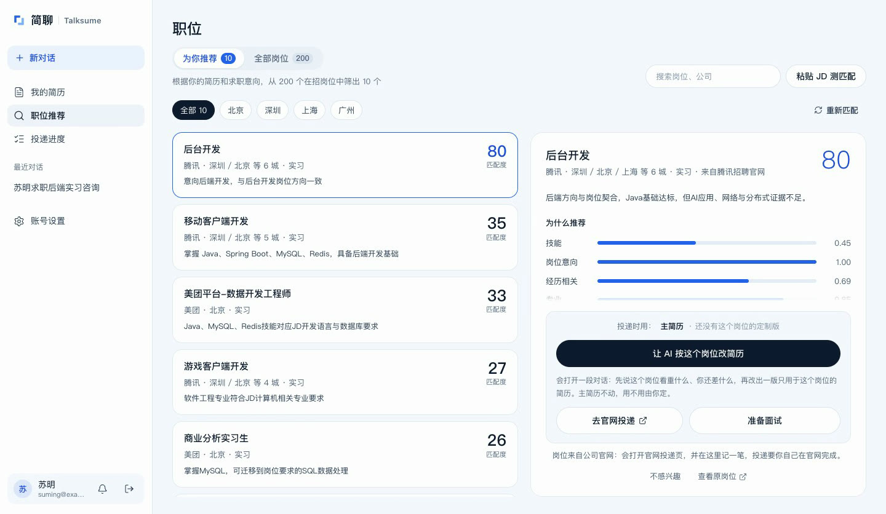
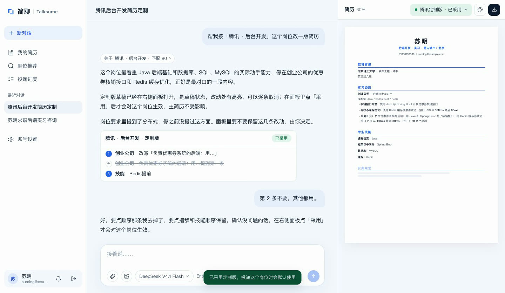
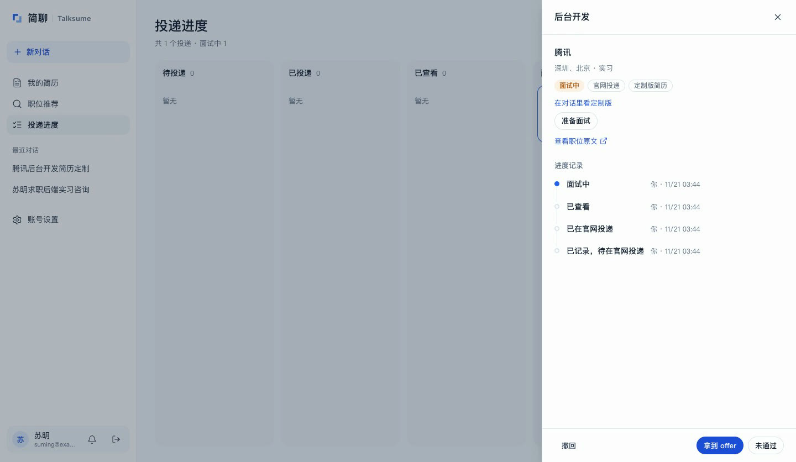
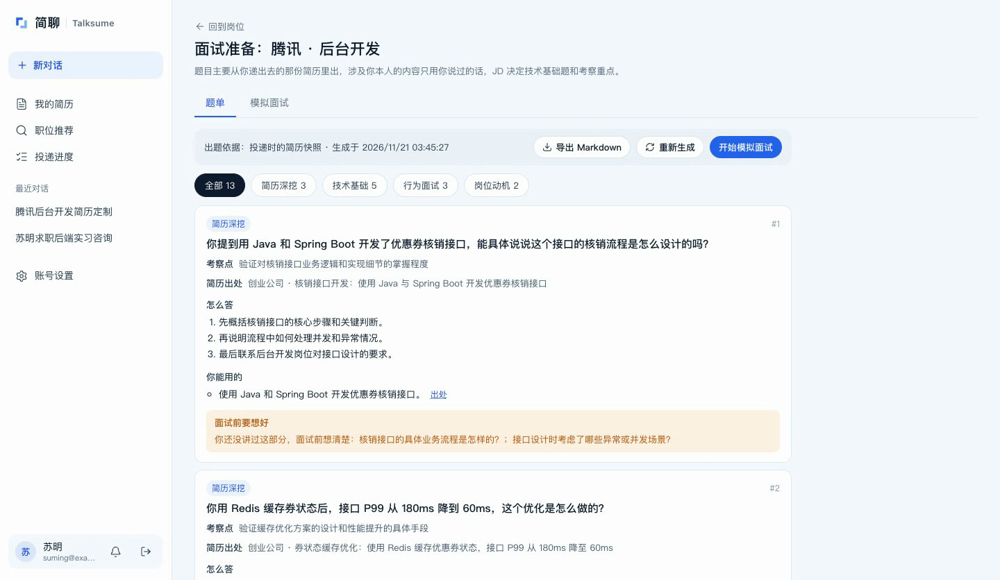
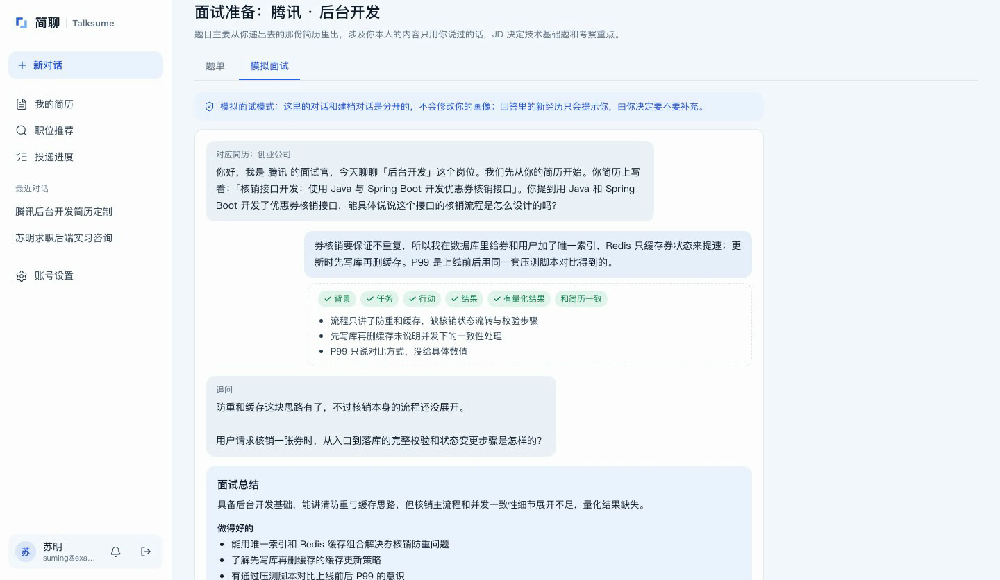
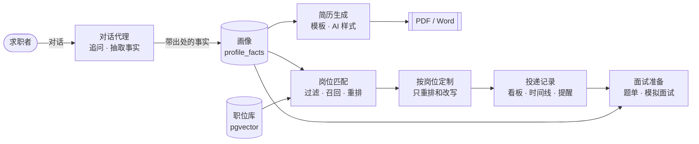

<div align="center">

# 简聊 Talksume

**聊出好简历，投中好岗位。**

用对话整理经历、生成简历，再按岗位推荐、定制简历、记录投递、准备面试。




</div>

## 为什么做简聊

写简历难在两头：一头是想不起、说不清自己做过什么，另一头是同一份简历投给不同岗位，没人告诉你哪里该突出。简聊把这两件事都放进对话里：助手一边追问一边记录，简历在右侧实时成形；看中一个岗位，再在对话里按这个岗位调整。

我们最看重的一点是**事实可信**。简历上的每一条内容都来自用户自己说过的话，并保留原话出处。大模型只负责追问和整理措辞，不能替用户编经历；按岗位定制时也只能重排和改写已有内容，不能新增事实。

## 功能

| | |
|---|---|
| **对话建档**<br>像聊天一样介绍自己，助手按缺口追问，抽取出的事实逐条写入简历并实时预览。能识别跑题、“没有”这类回答，要求写入没说过的内容时会先追问确认。也可以导入已有的 PDF 或 Word 简历再补充。 |  |
| **简历样式与导出**<br>内置多套预设模板和强调色，也可以让 AI 按描述或参考图设计新样式，保存前会自动检查有没有遮挡文字。支持导出 PDF 和 Word，单条要点可以在对话里润色。 |  |
| **职位推荐与匹配解释**<br>先按城市、岗位类型等硬条件过滤，再用关键词和语义向量召回，最后用重排模型打分。每个岗位都给出分项得分、命中和缺少的技能，以及 JD 原文出处。可以粘贴任意 JD 测匹配；点“不感兴趣”后，同类岗位会降权。 |  |
| **按岗位定制简历**<br>针对选中的岗位生成定制草稿，每处修改附依据，可以逐条勾选后再采用，也可以直接在对话里说“第 2 条不要”。采用后只生成定制版本，主简历保持不变。 |  |
| **官网投递与进度跟踪**<br>跳转到招聘官网，由本人完成投递，回来后在系统里记一笔。投递进度用看板按状态分栏，每次状态变化都写入时间线，长时间无回复会提醒跟进。 |  |
| **面试准备**<br>依据简历和目标岗位生成题单，每道题附考察点、答题思路，以及只取自用户原话的答题要点和简历出处，可导出 Markdown。 |  |
| **模拟面试**<br>面试官按题单逐题提问、追问并点评，结束后给出总结和改进清单。 |  |

## 工作方式



- **画像是唯一的数据源**：对话中确认的事实先进入画像，简历、匹配、定制、面试题单都从画像生成，因此能追溯到用户原话。
- **简历版本不可变**：内容或样式每变一次都落一份快照，投递时记录所用版本，保证投出去的就是当时看到的那份。
- **大模型网关**：主备两个模型，带超时、空闲超时和重试，请求前会脱敏个人信息；模型不可达时对话会降级提示，不会卡住。

## 技术栈

| 层 | 选型 |
|---|---|
| 前端 | React 19、Vite、React Router、TanStack Query |
| 后端 | Node.js（原生运行 TypeScript）、Fastify 5、Zod |
| 对话代理 | pi-agent-core，接 OpenAI 兼容接口的大模型，默认 DeepSeek V4.1 Flash，备用 GLM |
| 数据 | PostgreSQL 16 + pgvector（语义向量）+ pg_trgm（模糊搜索），Drizzle ORM；Redis 做通知分发和限流 |
| 匹配 | bge-m3 等向量模型召回，Qwen3-Reranker 等模型重排，规则引擎给出可解释的分项得分 |
| 简历渲染 | HTML 模板，Playwright（Chromium）导出 PDF，docx 导出 Word |
| 部署 | Docker Compose：postgres、redis、server、web（nginx） |

## 快速开始

### 用 Docker 部署

需要 Docker 和一个 OpenAI 兼容的大模型接口。

```bash
cp deploy/.env.example deploy/.env
# 编辑 deploy/.env：至少填 POSTGRES_PASSWORD、LLM_BASE_URL、LLM_API_KEY
docker compose -f deploy/docker-compose.yml up -d --build
```

启动后访问 `http://localhost:8000`，注册账号即可使用。首次启动会自动建表，并写入 200 条来自公开校招渠道的种子岗位。

常用配置（完整说明见 [`deploy/.env.example`](deploy/.env.example)）：

| 变量 | 作用 |
|---|---|
| `LLM_BASE_URL`、`LLM_API_KEY` | 大模型接口，必填 |
| `LLM_MODEL`、`LLM_FALLBACK_MODEL` | 主模型和备用模型，不填用默认值 |
| `EMBEDDING_BASE_URL`、`EMBEDDING_MODEL` | 向量模型，不填则只用关键词召回 |
| `RERANK_BASE_URL`、`RERANK_MODEL` | 重排模型，不填则跳过语义重排 |
| `AUTH_EMAIL_ENABLED` | 是否启用邮箱验证和找回密码，默认关闭；开启时需要配 `APP_URL` 和 `SMTP_*` |
| `WEB_PORT` | 对外端口，默认 8000 |

### 本地开发

需要 Node ≥ 22.19（推荐 24）、pnpm 12，以及一个开启 pgvector 的 PostgreSQL 16。

```bash
pnpm install

# 在仓库根目录建 .env，写入 DATABASE_URL 和 LLM_BASE_URL、LLM_API_KEY
pnpm dev:server       # http://localhost:8080
pnpm dev:cloud-web    # http://localhost:5173，/api 代理到 8080
```

服务端用 Node 原生的类型擦除直接运行 `.ts`，不需要构建，所以源码只能使用可擦除的 TypeScript 语法（`erasableSyntaxOnly`）。

提交前跑一遍：

```bash
pnpm lint && pnpm typecheck && pnpm test
```

## 目录结构

```text
apps/web               Web 前端：对话、简历、职位、投递、面试等页面
packages/core          领域模型：画像、简历、投递状态机，以及各类端口接口
packages/agent         对话代理：建档、定制、润色、面试的工具与提示词
packages/server        Fastify 应用工厂 buildApp(deps)，路由与业务流程
packages/db            Drizzle 表结构与迁移
packages/matching      岗位匹配：过滤、召回、重排、匹配解释、去重
packages/jobs-ingest   岗位采集与字段规范化
packages/resume-render 简历模板渲染、PDF 与 Word 导出
packages/llm-gateway   大模型网关：主备切换、超时重试、脱敏
cloud/                 云端版：注册登录、会话、邮件、限流，以及服务与前端入口
deploy/                Docker Compose、Dockerfile、nginx 配置
data/seed              种子岗位
```

`packages/*` 和 `apps/*` 不能引用 `cloud/`：`pnpm check:boundary` 检查引用，`pnpm verify:open-build` 会剔除 `cloud/` 后重新安装依赖、做类型检查并跑测试。
