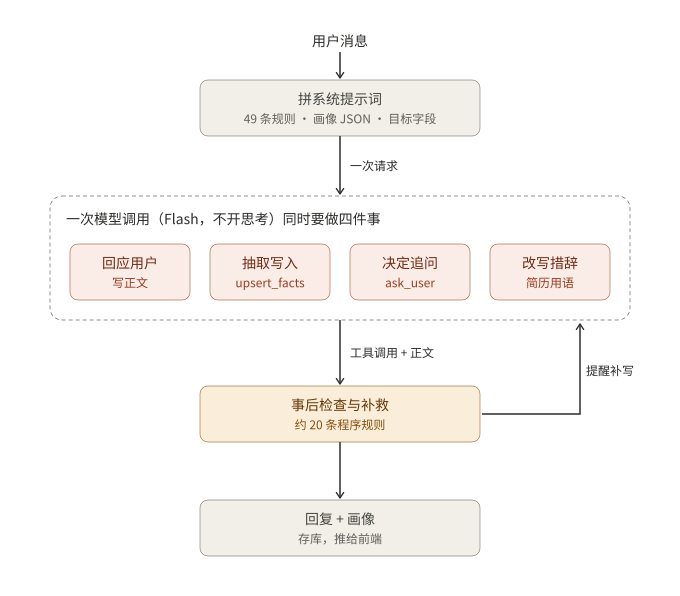
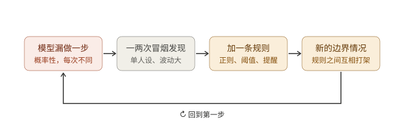
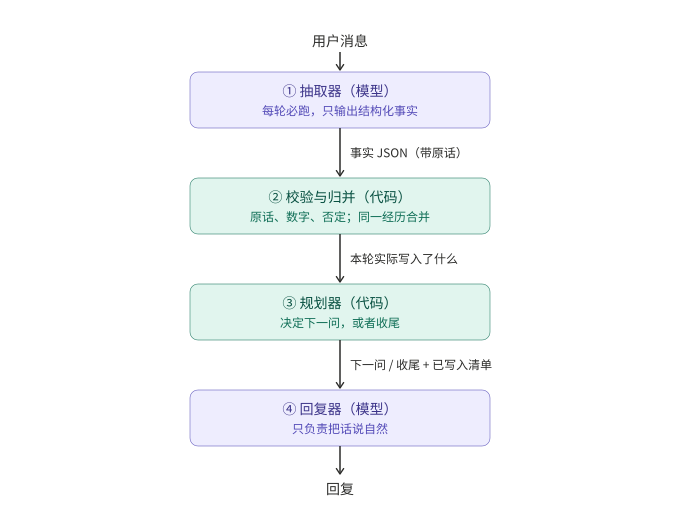

# 对话 Agent 设计诊断

2026-11-05。这份文档回答一个问题：为什么同类问题（漏记、重复条目、收尾后又追问）修了好几轮还会冒出来。

## 审查后的修订（11/05）

本文写完后，另一个会话独立审查了一遍，并用官方 DeepSeek 做了实验。结论是**有条件同意**。下面几处修订优先于正文。

1. **漏掉了影响最大的原因：历史回放。** `historyToMessages`（`controller.ts:129`）只回放岗位工具的调用记录，建档写入（`upsert_facts`）从来不进历史。所以在模型看来，前十几轮里它自己一直是「只回文字、不调写入」。
   - 把第二次冒烟第 15 轮（「没有，就学过 Java 和 MySQL」）之前的状态原样重建，同一句话重放 8 次：现状 0/8 写入技能；只把历史里的写入调用补回去，8/8 写入。
   - 整段冒烟加上回放后跑 3 次，技能、课程设计、义诊全都记下，没有重复条目，也没有收尾后追问，充实度 82/86/82。
2. **「一次调用做四件事」不准确。** 现在每轮平均 2.04 次调用，抽取和回复在调用层面本来就是分开的。真正的问题是两个：写不写由模型自己决定；下一问由模型和代码共同决定。
3. **换模型解决不了。**
   - 开思考：定点重放能写入，但整段冒烟里仍会漏，延迟还要高 2～5 倍。
   - 换 pro：定点只有 1/8。
   - 强制首次调用必须调工具（`toolChoice: required`）：遇到没有信息的消息时，会乱跳过、重复写入。这说明「强制」只能落在**没有副作用、允许返回空**的抽取器上。
4. **重复条目要单独设计。** 漏记、重复条目、收尾后追问不是三件独立的事，而是一条连锁：
   - `facts.ts` 按名字精确对齐条目，空项目「课程设计」因此被单独建了出来；
   - 空项目缺 `role`，生成了一个假的必填目标；
   - 这个假目标一边误导模型，一边触发了「不过还差一项」。
   
   四步结构不会自动消除这个问题，需要单独设计条目身份：裸确认不建条目，说出名字后改名或合并。
5. **规则清单不全**：实际约 30 条。断流续写和半句扣留是网络问题，新结构里仍要保留；短拒答自动跳过是确定性的规则，也应该保留。
6. **评测改成两层**，详见第 5 节的补充。
7. **分阶段落地，不整体重写**，每阶段过门槛才进下一阶段，详见第 6 节。

审查报告全文在会话共享笔记 `agent-design-review.md`，实验脚本和原始输出在审查会话的 scratchpad。

## 结论（初稿）

问题不在某几个 bug，而在结构。现在一次模型调用要同时做四件事：回应用户、抽取写入、决定追问、改写措辞。系统提示词里有 49 条规则，做漏了再靠大约 20 条程序规则补救。

模型漏做哪一步是概率性的，每次漏的都不一样。每补一条规则，只能堵住一种表现，还会和已有的规则互相影响。所以修一个，冒一个。

建议把这一次调用拆成四步：抽取、校验、规划、回复，每步只管一件事。在动手之前，先把评测改成「多人设、每个人设跑多次、统计比率」，否则改完也判断不了到底变好没有。

## 1. 现在的设计

一轮对话的处理流程（`packages/agent/src/controller.ts` 的 `runTurn`）：

1. **拼提示词**：`prompt.ts` 的 `buildSystemPrompt` 把 49 条规则、整份画像 JSON、系统选出的「当前目标字段」拼成系统提示词，约 8.8k token。
2. **一次模型调用**：DeepSeek Flash，不开思考，ReAct 循环，每轮最多 5 次模型往返。模型在同一次输出里要完成：
   - 写一段回应用户的正文；
   - 自己判断要不要调 `upsert_facts`，写哪些字段，quote 摘哪句原话；
   - 自己判断是追问、跳过（`skip_field`）、结束分区（`complete_section`），还是收尾；
   - 写入 highlights 时，顺手把口语改写成简历用语。
3. **事后检查与补救**：工具执行时和这一轮结束时，程序规则逐条检查。发现漏了就 `steer` 一条系统提示让模型重来，或者直接改结果。
4. **存库**：回复和画像变更写进历史，推给前端。

### 现有的事后规则

| # | 规则 | 补的是什么 | 位置 |
|---|---|---|---|
| 1 | quote 逐字校验 | 模型编造原话 | `tools.ts` `quoteInCorpus` |
| 2 | 数字、英文词、拔高词要有出处 | 编造数字、「主导」「独立」 | `facts.ts` + core `ungroundedTokens` |
| 3 | 熟练度要有程度词 | 推断「精通」 | `facts.ts` |
| 4 | 年月要有出处 | 「大二下」被换算成年月 | `facts.ts` |
| 5 | 否定词拦截 | 「Git 没用过」被记成技能 | `facts.ts` `negatedIn` |
| 6 | 改写校验，不合格退回原话 | 改写时加了内容 | `wording.ts` |
| 7 | 「记下了」谎称检测 | 嘴上说记了，实际没写 | `controller.ts` `claimedSubjects` |
| 8 | 答了没写就提醒 | 深挖题答了却没写入 | `tools.ts` `answeredSlot` |
| 9 | 被拒条目重写一次 | 写入和追问同时发出，被拒的没机会改 | `controller.ts` `REPAIR_TEXT` |
| 10 | 断流续写 | 上游断流丢答案 | `controller.ts` `resumeText` |
| 11 | 半句扣留 | 断流时半句话露出来 | `controller.ts` `sendText` |
| 12 | 短拒答自动跳过 | 用户说「没有」，模型忘了跳过 | `tools.ts` `skipDeclined` |
| 13 | 想跳没跳成就代跳 | `skip_field` 参数错，下一轮卡住 | `controller.ts` |
| 14 | 写入失败就澄清，同一句不重复澄清 | 反复问「再具体说一下」 | `controller.ts` `clarified` |
| 15 | 兜底追问 + 收尾识别 | 模型没提问；收尾后又拼追问 | `tools.ts` `fallbackQuestion` / `WRAP_UP` |
| 16 | 正文问过就不再用 ask_user 的问题 | 一条回复问两遍 | `controller.ts` emit |
| 17 | 程序化更正「还没记进简历」 | 谎称记下且补写失败 | `controller.ts` |
| 18 | AI 提的候选要用户确认 | 把建议当成事实写入 | `tools.ts` `unconfirmedValues` |
| 19 | 矛盾检测 + 确认按钮 | 新说法覆盖旧说法 | `facts.ts` conflicts |
| 20 | 必填项没齐先暂存 | 半截条目进简历 | `facts.ts` drafts |

前 6 条守的是「写进去的必须是真的」，这一侧很稳：eval 的 Precision 一直在 97%～99.4%。第 7～17 条补的都是另一侧，也就是「该写的有没有写、该问的问对没有」，问题反复出现的正是这一侧。

## 2. 反复出现的问题，都指向同一个原因

以下例子都来自 11/04～11/05 的冒烟记录，人设是虚构学生李明。

| 症状 | 根子上是哪件事 | 现在怎么补 | 为什么补不全 |
|---|---|---|---|
| 说过的细节没记（乱码 → UTF-8；第二次冒烟里技能整区没记） | 写不写全靠模型自己想起来调 `upsert_facts` | 第 8 条：答了没写就提醒 | 只覆盖深挖题；技能不是深挖题，提醒不会触发 |
| 嘴上说「记下了」，实际没写 | 回应和写入在同一次输出里，谁也不核对谁 | 第 7 条：正则抓「记下了」 | 换个说法（「我记着」「加进去」）就抓不到 |
| 收尾后又追问；同一个问题问两遍 | 「下一问」有两个来源：模型正文和系统兜底 | 第 15、16 条：问号检测 + 收尾正则 | 模型说「基本情况都聊得差不多了」，正则只认「差不多齐了」，兜底照样拼了一句「不过还差一项：你在项目里担任什么角色？」 |
| 出现「课程设计」和「学生成绩管理系统」两个条目 | 条目按名字对齐，模型在名字说出来之前就建了条目 | 没有补 | 没有归并这一步 |
| 「Git 没用过」记成技能；「大二下」换算成年月 | 抽取时模型自己推断 | 第 4、5 条，按类别逐个加 | 推断的种类没有尽头 |

## 3. 为什么修了又冒出来

- **失败是概率性的，冒烟次数太少。** 同一份代码、同一个人设，今天两次冒烟的充实度一次 77%，一次 59%。第一次所有内容都记全了，第二次技能整区没记，还多了一个空项目。只跑一两次就判断「修好了」，看到的其实是噪声。
- **规则会互相影响。** 兜底追问要先判断模型是不是在收尾，提醒文案要分「问题已发出、正在收尾、还没提问」三种情况，断流续写又要判断问题问出口没有。每加一条规则，就要和前面所有规则对一遍。
- **提示词越补越长。** 49 条规则大多是一次次修补加上去的。Flash 不开思考，规则越多，每一条被遵守的概率越低，又反过来需要更多事后规则。

## 4. 建议的结构

每轮固定走四步：

1. **抽取器（模型）**：每轮必跑，不靠模型想起来调工具。输入是这一句用户消息、上一个问题、画像摘要，输出结构化事实（带原话）和意图（建档 / 问岗位 / 闲聊）。改写成简历用语也放在这里，一起输出。
2. **校验与归并（代码）**：现有第 1～6 条和第 18～20 条原样保留。新增条目归并：项目名还没说出来时先暂存，说出名字后合进同一条。
3. **规划器（代码）**：现有的 completeness 和 slot 体系已经在做这件事，只是现在还要和模型商量。改成由它唯一决定下一问，或者收尾。
4. **回复器（模型）**：只负责把话说自然。它拿到的是「这一轮实际写入了什么」和「要问的问题或要收尾」，不再自己判断写没写、问什么。提示词预计十几条。

这样拆完，现在第 7、8、9、12、13、15、16、17 条规则（谎称检测、答了没写的提醒、兜底拼问题、收尾正则……）就没有存在的必要了，因为它们要补的那类错，在结构上不会再发生。

**成本和速度**：每轮仍是两次模型调用（现在平均 2.04 次）。抽取器只输出短 JSON，回复器流式输出，首字时间估计和现在差不多，这一点要实测。

**不变的部分**：岗位推荐、解读和定制这几个工具不动。抽取器判断出「问岗位」的意图时，走现有的工具调用流程。

**风险**：
- `controller.ts` 基本要重写，`tools.ts` 的建档工具会变成内部函数。
- 回复器不知道用户原话细节的话，回应可能变得干巴巴，所以要把这一轮的用户原话也给它。
- 岗位和建档混在同一句话里的情况，要单独设计。

## 5. 评测要先改

不先改评测，就无法判断上面的改动是不是真的更好。

- **场景回归集**：5～6 个人设（经历少的专科生、有实习的本科生、转专业的、一次说很多的、爱跑题的），每个人设跑 5 次。
- **统计行为比率，不看单次**：
  - 说过的内容被记下的比例；
  - 重复或空条目的数量；
  - 一条回复问两遍、收尾后又追问的比例；
  - 嘴上说记了、实际没写的比例；
  - 防编造的 Precision（沿用现有的 eval）。
- 用官方 DeepSeek 跑，6 段对话的 eval 约 52 万 token，0 次失败，可以每次改动都跑一遍。

### 补充：两层评测（审查后）

整段冒烟的方差，大部分来自模拟用户每次走的路径不同：同一份代码 12 次整段冒烟，轮数在 19～28 之间，充实度在 64～86 之间。所以评测分两层：

- **第 1 层：冻结状态的定点探针（主力）。** 从冒烟里截取 20～30 个难点时刻，重建当时的完整状态，然后对下一句用户话重放 8～16 次。判定全部由程序完成：比较本轮前后的画像差异，统计问句数量。每次改动都全量跑一遍，大约 200 次单轮调用。
- **第 2 层：多人设整段对话。**
  - 每个人设配一份标准答案画像，召回只算用户实际说过的内容；
  - 新旧两版交替运行，用按运行聚类的 bootstrap 求置信区间；
  - 「假称已记录」用模型判定，判定器先用 30 条人工标注校准一次。
- **动工前写死合并门槛**：
  - 探针集的写入正确率提升，且置信区间不跨 0；
  - 任何单个探针不退步超过 2/8；
  - 防编造 Precision 下降不超过 1 个百分点；
  - 整段对话里的空或重复条目为 0；
  - 首字 p50 不比基线慢 20% 以上。

## 6. 执行计划（审查后）

| 步骤 | 做什么 | 验收 |
|---|---|---|
| S0 评测 | 定点探针（第一批 12 个，有程序判定器）+ 多人设整段脚本，在 main 上测出基线 | 同一份代码跑两遍，探针结果差异 ≤1/8 |
| S1a 历史回放 | 建档工具调用写进历史并原样回放 | 技能探针 ≥7/8，所有探针都不退步 |
| S1b 条目身份 | 裸确认和泛称不建条目；说出名字后改名或合并；规划器不再为空条目出题 | 「裸确认 → 说出名字」探针 8/8 只有一个条目 |
| S2 抽取器 | 每轮必跑一次结构化抽取，没有副作用，允许返回空；`upsert_facts` 不再作为模型工具 | eval 的 P 不降、R 不低于基线；没有信息的消息 0 写入、0 跳过；首字时间不慢 20% 以上 |
| S3 规划器 + 回复器 | 由代码唯一决定下一问或收尾；回复器只负责措辞；问岗位时路由到只带岗位工具的 ReAct | 一条回复问两遍、收尾后又问、过早收尾都为 0；自然度不下降 |

S1a 和 S1b 可以并行。S0～S2 在 11/20 前有把握完成；S3 到 11/15 还没过门槛的话就先不合，初赛用 S2 的版本提交。

## S3 精简版（实施记录）

做在 S1 之后、不拆 `upsert_facts` 的前提下：**下一问和收尾只由代码决定**（`tools.ts` 的 `planNext`），模型只负责把话说自然。

| 谁决定 | 什么 |
|---|---|
| `planNext`（代码） | 本轮是问某一项（`ask`）、首次收尾（`wrap`）、已收尾（`closed`，不再提问）、还是等矛盾确认（`hold`）；深挖和选填共用 6 项预算，必填基础项和挖掘角度不占 |
| 流式层（代码） | 不该问的时候问句拦下；还要问的时候模型自己写的收尾句拦下；一条回复只留一个问句 |
| 收尾（代码） | 该收尾而模型没写收尾说法，补一句；收尾后用户只回致谢或客套（`isPleasantry`），代码直接回一句，不调模型 |
| `skip_field`（代码） | 只能跳过上一轮问过、且用户这句话里有拒答字眼的那一项；闲聊或没有信息的消息被拦下 |
| 模型 | 写回应、写入事实（`upsert_facts`）、附快捷回答 |

删掉的兜底：规则 15（`fallbackQuestion` 和按收尾正则拼「不过还差一项」）、规则 16（按正文里有没有问号决定用不用 `ask_user` 的问题，改成流式层的单问句）、规则 13（`skip_field` 失败后代跳）。规则 7、8、9、17 管的是「该写的有没有写」，写入仍由模型决定（S2 才会改），所以保留，只把它们的提示改成跟着 `planNext` 走。数据和门槛见交接笔记 `s3-planner-handover.md`。
