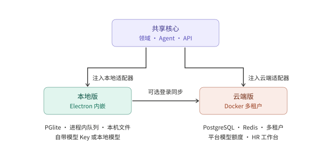
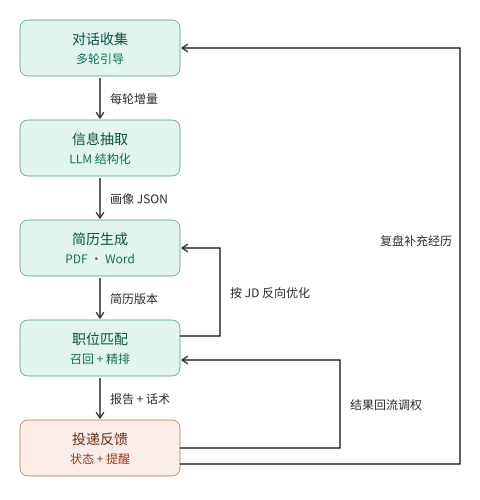
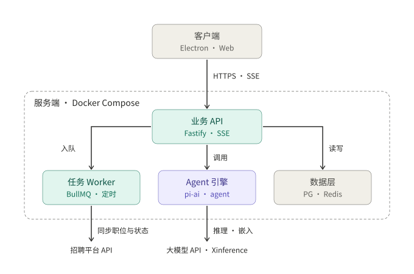
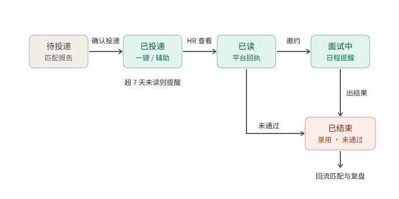
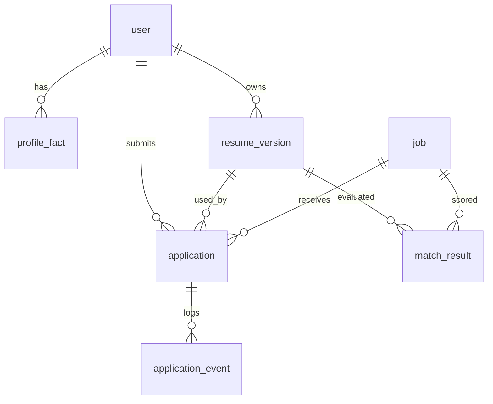

## 1. 产品定位

求职者用聊天的方式说出自己的经历，系统帮他整理成一份可以直接投递的简历。之后系统负责找岗位、给出投递建议、跟踪投递进度并主动提醒。每一次投递结果都会回流，用来调整后续的岗位推荐和简历内容。

### 1.1 用户旅程

以「计算机专业大三学生找暑期后端实习」为例。决赛的演示视频也按这条线录制。

| 阶段 | 用户做什么 | 系统做什么 |
|---|---|---|
| 首次使用（约 15 分钟） | 选本地模式或登录云端；上传旧简历，或直接开聊 | 按缺失的字段追问，项目经历追问到能量化；右侧简历实时生成，并显示完整度 |
| 确认意向、拿到简历 | 确认方向、城市、薪资；选模板 | 导出通用版 v1（PDF / Word） |
| 看推荐 | 对岗位点感兴趣、不感兴趣（选原因）或投递 | 每个岗位给出匹配度、五个维度得分，以及优势和差距 |
| 定制简历 | 点「为这个岗位优化」，逐条采纳修改建议 | 每条修改都标明依据的是用户哪句原话，采纳后生成定制版 v1.1 |
| 投递 | 一键投递，或去第三方平台由自己提交 | 飞书招聘：通过 API 投递；第三方网站：浏览器助手打开职位页并填好话术，停在发送按钮；其他渠道：用户登记 |
| 等待与跟进 | 看投递看板，接收通知 | 状态变化时提醒；超过 7 天未读，提醒跟进并给出话术；收到面试邀请后生成面试准备卡 |
| 面试复盘 | 回答复盘问题，登记面试结果 | 把新经历和暴露的薄弱点补进画像，并更新匹配权重；推荐变化时说明原因 |

### 1.2 两个版本

产品分为简聊（本地版）和简聊 Cloud（云端版）两个版本，共用同一个核心，区别只在注入的适配器（见下图和第 3.2 节）：

| | 本地版（桌面端） | 云端版（SaaS） |
|---|---|---|
| 面向 | 重视隐私的个人求职者 | 个人求职者 + 企业 HR |
| 形态 | Electron 安装包，内嵌服务端 | Docker Compose 部署；Web 端和桌面端都可以连接 |
| 数据 | 存在本机：PGlite（带 pgvector）+ 本地文件 | 云端存储：PostgreSQL + Redis + 对象存储，多租户隔离 |
| 模型 | 用户自带 API Key，或接本机的 Xinference / Ollama | 平台统一提供，按套餐给额度 |
| 职位库 | 从云端的公开职位接口拉取，简历不出本机 | 云端统一采集，也包括企业在 HR 工作台发布的岗位 |
| 投递 | 辅助投递，由用户回填状态 | 平台 API 投递（飞书招聘）+ HR 工作台 + 辅助投递 |
| 提醒 | 系统通知 | 站内推送、邮件；桌面端连接时也弹系统通知 |
| 互通 | 可选登录云端账号，同步画像和投递记录 | — |

{.w62}

::: note
参赛时，部署到比赛服务器并现场演示的是云端版（单租户部署），本地版作为桌面端产品额外展示。
:::

## 2. 业务闭环

{.side}

主链路是「对话收集 → 信息抽取 → 简历生成 → 职位匹配 → 投递反馈」五步，下表逐一说明。三条回流让这个闭环转起来：

1. **按 JD 反向优化简历**：针对某个岗位，生成简历修改建议，展示为修改前后对比，用户逐条采纳后生成新版本。每条建议都必须引用画像里的事实，否则会被校验器拒绝（第 4.3 节）。
2. **结果回流调权**：用户的「不感兴趣」、投递、面试、录用、被拒等行为，会更新这个用户在各个匹配维度上的权重（第 4.4 节）。
3. **复盘补充经历**：面试结束后，系统发起一段复盘对话，把新获得的经历或被追问的薄弱点补进画像。

每次投递状态迁移都会写入事件表并触发一条通知，状态机见第 4.5 节。

::: clear
:::

| 环节 | 输入 → 输出 | 关键机制 |
|---|---|---|
| 对话收集 | 用户自然语言 → 对话消息 | 由系统根据「缺哪些字段」来决定下一句问什么，不靠模型自由发挥；项目经历按 STAR 结构追问，并要求量化结果 |
| 信息抽取 | 每轮消息 → 画像增量（结构化补丁） | 大模型通过工具调用输出补丁，再经 Schema 校验后写入「事实表」；每条事实都记录它来自哪条原话 |
| 简历生成 | 画像 → 简历版本 → PDF / Word | 同一份画像可以按不同目标岗位生成多个版本；左侧对话、右侧实时预览，用户也可以直接改表单 |
| 职位匹配 | 求职意向 + 简历 → 排序后的职位与匹配报告 | 先按条件过滤，再做向量召回，最后由大模型分维度打分；报告里写明差距在哪、投递话术怎么说 |
| 投递反馈 | 投递动作 → 状态流转 → 提醒 | 状态来源有三种：平台回调、HR 工作台、用户手动回填；每次状态变化都会推送提醒 |

## 3. 系统架构

{.w62}

| 模块 | 技术 | 职责 |
|---|---|---|
| 客户端 | Electron + React + Ant Design | 对话、简历预览与编辑、职位看板、投递看板、通知中心；Web 端和桌面端共用同一份渲染层代码 |
| 业务 API | Node.js 22 + Fastify + Zod | REST 接口与 SSE 流式推送、鉴权、状态机、投递记录 |
| Agent 引擎 | `@earendil-works/pi-ai` / `pi-agent-core` / `pi-schema` 1.4.0（锁定版本） | 多模型网关、工具调用循环、结构化输出校验；只做推理编排，不直接读写业务表 |
| 任务 Worker | BullMQ | 职位同步、批量匹配、超时提醒、平台状态轮询、导出任务；带失败重试和死信队列 |
| 数据层 | PostgreSQL 16 + pgvector、Redis 7、本地卷存放导出文件 | 业务数据、职位向量、队列与缓存 |
| 外部服务 | DeepSeek / 通义（OpenAI 兼容接口），Xinference（嵌入与重排），招聘平台 API | 第 6 节说明 |

### 3.1 关键选型与取舍

- **全栈 TypeScript + Electron**：pi、Electron、API 共用一门语言，画像 Schema、状态枚举、接口类型从同一个包导出。pi 和 Playwright 都运行在 Node 上，Electron 能把它们连同整个服务端直接内嵌进本地版；Tauri 还需要额外打包一个 Node sidecar 进程。
- **Agent 引擎选 pi-mono，不选 xagent**：
  - pi 是 MIT 协议的库，按需 import 三个包即可，内置 DeepSeek、通义，也能接 OpenAI 兼容端点（如 Xinference）。为隔离它的不兼容改动，锁定版本，业务代码只依赖自己的 `llm-gateway` 适配层。pi-durable 标着「实验性」，不用。
  - xagent 是 7 个容器的完整平台，难以嵌入；它的许可证 §4.1 禁止把编排能力以网络服务的形式提供给第三方，和面向公众的多用户产品冲突。
- **借鉴 career-ops（MIT）的设计**：分维度打分与证据分级、投递状态枚举、防编造校验、ATS 友好的简历模板，在代码中注明出处。不 fork 它，因为它以本地文件为数据源，没有数据库和多用户体系。

### 3.2 两个版本如何共用一个核心

核心只依赖五个接口（端口），两个版本各自提供一套实现（适配器），在启动时注入：

| 端口 | 本地版 | 云端版 |
|---|---|---|
| `Db` | PGlite + pgvector | PostgreSQL + pgvector |
| `JobQueue` | 进程内调度，任务表持久化在 PGlite | BullMQ + Redis |
| `BlobStore` | 本机目录 | S3 兼容对象存储 |
| `Notifier` | 系统通知 | SSE 推送 + 邮件 |
| `PlatformConnector` | 仅辅助投递 | 飞书招聘、HR 工作台、辅助投递 |

- 两个版本的数据库都是 PostgreSQL 方言（本地版用 PGlite），所以只需要一套 SQL 和一套迁移。
- 云端版独有的能力放在 `cloud/` 目录：多租户、套餐与额度、HR 工作台、平台连接器。这部分以后可以像 xagent-saas 那样拆成私有仓库，用 submodule 引用开源的核心仓库；独有的表加 `cloud_` 前缀，并使用独立的迁移版本表。比赛期间为了满足「完整源代码」的提交要求，仍然放在同一个公开仓库里。

## 4. 核心模块设计

### 4.1 对话引擎（对话收集 + 信息抽取）

- **画像 Schema**：用 pi-schema 定义，包含基本信息、教育、实习/工作、项目、技能、获奖、求职意向七个分区；每个字段标记为必填或选填，并带权重。
- **每一轮对话的处理流程**：
  1. 控制器按「完整度 × 字段权重」挑出下一个要补的字段，把它和追问策略一起注入系统提示词。
  2. Agent 只能调用三个工具：`upsert_facts`（写入事实，必须附原话片段）、`ask_user`（追问）、`complete_section`（结束当前分区）。
  3. 工具参数先过 Schema 校验，不通过就让模型修正一次；还不通过，就改为向用户澄清。
  4. 校验通过的事实写入数据库，重新计算完整度，再通过 SSE 把文字流、画像补丁和完整度推给前端。
- **边界情况**：跑题时礼貌拉回；一句话含多个事实就批量写入；前后矛盾时弹「请确认」卡片，不静默覆盖；模型超时或限流时重试并切换备用模型；用户不想聊时，随时可切到表单模式。
- **导入旧简历**：上传 PDF 后抽取文本，走同一套抽取流程，生成一批待确认的事实。

### 4.2 简历生成

- 画像按目标岗位选材、排序，得到简历内容 JSON，再用 HTML 模板渲染：PDF 由 Playwright 生成；Word 由 `docx` 库生成，打开后仍可编辑。
- 先做 3 套模板（校招单页、技术岗、通用），内嵌思源黑体，保证中文排版一致。
- 每个简历版本记录对应的画像版本和目标岗位，任意两个版本可以对比差异。

### 4.3 按 JD 反向优化与防编造

- 大模型读取 JD 和当前简历，输出一组修改建议，每条格式为 `{位置, 原文, 新文, 依据事实 ID, 理由}`。
- 校验器检查每一条建议：新文里出现的数字、公司名、技术名词，必须能在它引用的事实里找到；找不到的建议直接丢弃，并记入日志。
- 页面上把建议逐条展示为对比，用户采纳后生成新的简历版本。

### 4.4 职位匹配与反馈学习

1. **硬过滤**：城市、薪资下限、学历、招聘类型（校招/社招/实习）不满足的岗位直接排除。
2. **召回**：把简历的嵌入向量和 JD 的嵌入向量做 pgvector 余弦相似度检索，取前 100 个。
3. **精排**：大模型对前 30 个岗位按五个维度打 1–5 分：技能匹配、经历相关、意向契合、门槛满足、风险信号。总分 = Σ 用户权重 × 维度分；同时生成匹配报告，写明优势、差距和投递话术。
4. **反馈学习**：用户行为记为强度不同的信号：不感兴趣 −1、投递 +1、已读未回 −0.3、面试 +2、录用 +3、被拒 −1（附原因）。用在线逻辑回归更新该用户的五维权重，新用户从全局权重起步；权重变化会在界面上解释，例如「你更看重意向契合，已为你调高」。

### 4.5 投递与提醒

{.w70}

投递渠道有三种：

| 渠道 | 说明 | 状态来源 |
|---|---|---|
| 平台 API 投递（云端版） | 飞书招聘开放接口：先 `POST /hire/v1/talents/combined_create` 创建人才，再 `POST /hire/v1/applications` 创建投递（`delivery_type=2` 表示候选人主动投递） | 订阅 `hire.application.stage_changed_v1` 事件（Webhook），再用 `GET /hire/v1/applications/:id` 定时对账 |
| 内置职位 | 投给 HR 工作台里发布的岗位 | HR 在工作台推进状态 |
| 辅助投递（本地版浏览器助手） | 求职网站：内嵌浏览器使用用户自己的登录态，一键导入当前页面的 JD，打开职位页并填好话术，停在发送按钮由用户点击；不做批量投递或后台自动操作，遇到验证码交给用户处理 | 用户打开沟通列表时读取状态，或由用户回填 |

提醒的触发条件有三类：状态发生变化、超过 7 天未读、面试前 24 小时。提醒通过 SSE 推送；桌面端同时弹出系统通知，离线期间产生的通知在下次上线时补发。

## 5. 核心接口（`/api/v1`，JWT 鉴权）

| 方法与路径 | 说明 |
|---|---|
| `POST /conversations` / `POST /conversations/:id/messages` | 创建会话 / 发送消息；返回 SSE 流，事件类型：`token`、`profile_patch`、`ask`、`completeness`、`error` |
| `GET /profile` / `PATCH /profile` / `POST /profile/import` | 读取画像 / 用 JSON Patch 修改画像 / 上传旧简历导入 |
| `POST /resumes` / `GET /resumes/:id/export` | 生成简历版本 / 导出文件（`format` 取 `pdf` 或 `docx`） |
| `POST /resumes/:id/tailor` `{jobId}` / `POST /resumes/:id/tailor/:sid/accept` | 生成针对某岗位的修改建议 / 采纳一条建议 |
| `PUT /preferences` | 设置求职意向（岗位、城市、薪资、招聘类型） |
| `GET /matches` / `GET /matches/:jobId/report` / `POST /matches/:jobId/feedback` | 匹配列表 / 匹配报告 / 用户反馈 |
| `POST /applications` / `GET /applications` / `PATCH /applications/:id/status` | 发起投递 / 投递列表 / 用户回填状态 |
| `GET /notifications/stream` | SSE 通知流 |
| `POST /hr/jobs` / `POST /hr/applications/:id/transition` | HR 发布岗位 / 推进投递状态 |
| `POST /webhooks/:platform` | 招聘平台状态回调，校验签名后保证幂等处理 |

错误统一返回 `{code, message, retryable}`。模型被限流（429）时，同步请求降级到备用模型，异步任务按指数退避重试，最多 3 次。

## 6. 关键表结构

上图只画核心实体；`profile`、`conversation`、`message`、`feedback`、`notification`、`llm_call_log` 都挂在 `user` 下，字段见下表。

| 表 | 关键字段 |
|---|---|
| `profile` | `user_id` PK、`data` JSONB、`version`、`completeness` JSONB、`weights` JSONB（匹配维度权重） |
| `profile_fact` | `id`、`user_id`、`section`、`payload` JSONB、`source_message_id`、`status`（待确认 / 已确认 / 被覆盖） |
| `resume_version` | `id`、`user_id`、`profile_version`、`target_job_id`、`template`、`content` JSONB、`pdf_key`、`docx_key` |
| `job` | `id`、`source`、`source_job_id`（与 `source` 组成联合唯一键）、`company`、`title`、`city`、`salary_min/max`、`degree`、`jd_text`、`embedding vector(1024)`、`status` |
| `match_result` | `user_id`、`job_id`、`resume_version_id`、`score`、`dims` JSONB、`report` JSONB、`model` |
| `application` | `id`、`user_id`、`job_id`、`resume_version_id`、`channel`、`status`、`external_id`、`pitch` |
| `application_event` | `application_id`、`from_status`、`to_status`、`source`（平台 / HR / 用户 / 系统）、`payload` |
| `feedback` / `notification` / `llm_call_log` | 反馈信号 / 站内通知 / 每次模型调用的用途、模型、token 数、耗时、结果（用于成本统计和问题排查） |

## 7. AI 服务集成说明

| 场景 | 模型 / 服务 | 调用方式 | 代码位置 | 降级方案 |
|---|---|---|---|---|
| 对话引导与事实抽取 | DeepSeek-V3（`deepseek-chat`） | pi-agent-core 工具循环 + pi-schema 校验 | `packages/agent/intake` | 切换到通义；再失败就切到表单模式 |
| 简历润色与按 JD 改写 | 同上 | 结构化输出 + 防编造校验器 | `packages/agent/tailor` | 只给出差距提示，不生成改写 |
| 岗位精排与匹配报告 | 同上 | 批量任务在 Worker 中执行 | `apps/worker/match` | 只按召回分排序 |
| 嵌入与重排 | bge-m3、bge-reranker（Xinference，OpenAI 兼容接口） | HTTP | `packages/llm-gateway` | 改用云端嵌入 API |
| 截图回填投递状态 | 多模态模型 | 单次调用 | `apps/api/applications` | 用户手动选择状态 |

所有模型调用都经过 `llm-gateway`，由它统一处理密钥、超时、重试、降级、日志和 PII 脱敏（手机号、邮箱在发送给模型前替换为占位符）。

## 8. 可行性分析

### 8.1 技术可行性

闭环的五个环节都有成熟的组件可用：对话与抽取用 pi + 主流大模型，导出用 Playwright 和 docx，检索用 pgvector，任务用 BullMQ。全部组件都可以容器化。主要难点在于抽取准确率、按 JD 改写时不编造内容，以及投递状态能否真实回流，对应的验证项见第 8.4 节。

### 8.2 数据可行性

| 数据 | 获取方式 | 风险 |
|---|---|---|
| 职位 | 1）企业招聘官网的公开职位接口；2）海外 ATS 的公开接口（Greenhouse、Lever 等，career-ops 已验证可用）；3）HR 工作台自建岗位 + 人工整理的 200 条真实 JD 种子数据 | 1）需要逐个核实接口可用性和使用条款，只存公开字段和原文链接 |
| 用户经历 | 团队成员及 10 名同学志愿者的真实经历，脱敏后作为对话测试集 | 隐私：签署知情同意，数据只用于测试 |
| 投递状态 | 平台回调 / HR 工作台 / 用户回填 | 平台 API 的可用性是最大风险，见 V6 |

### 8.3 时间可行性（按 3 人分工：A 前端与桌面端，B 服务端与部署，C 智能体与匹配）

| 时间 | 里程碑 |
|---|---|
| 11/03–11/05 | 报名；提交飞书招聘试用申请；建好代码仓库骨架，`docker compose up` 能启动 API、数据库、Web；Electron 壳能打开 |
| 11/05–11/09 | 完成验证 V1–V6，并留下证据 |
| 11/09–11/17 | 最小闭环跑通：对话 → 简历 → 匹配 → 投递 → HR 推进状态 → 收到提醒 |
| 11/17–11/20 | 初赛文档、验证证据、源代码初版 |
| 11/21–12/06 | 反向优化、反馈调权、桌面端通知与投递助手、平台 API 对接 |
| 12/07–12/13 | 边界情况与稳定性（限流、降级、重试、幂等）、安全（鉴权、越权、PII）、测试 |
| 12/14–12/20 | 在纯净服务器上演练部署 3 次，录制演示视频，定稿文档 |

### 8.4 初步验证项（初赛提交证据）

| 编号 | 验证内容 | 方法与通过标准 |
|---|---|---|
| V1 | 对话信息抽取 | 准备 20 段人工标注的对话，统计字段级 F1，目标 ≥ 0.90；附抽取样例 |
| V2 | 职位数据源连通性 | 至少 2 个数据源，各拉取不少于 300 条；附脚本和截图 |
| V3 | 匹配质量 | 10 个画像，每个对前 10 个推荐岗位做人工相关性标注，命中率 ≥ 70% |
| V4 | 防编造 | 50 条改写建议，校验器的漏检率 ≤ 5% |
| V5 | 导出质量 | 生成的 PDF / Word 分别在 Office、WPS、macOS 预览中打开，截图证明中文排版正常 |
| V6 | 真实平台 API 投递 | 开通飞书招聘（团队自建企业租户，申请试用），完整走一遍：创建职位 → 通过 API 创建人才和投递 → HR 推进阶段 → 收到 `stage_changed` 回调；附截图和回调日志。备选是实习僧开放平台（需要找商务申请）；两条路都不通，就降级为辅助投递，主线不受影响 |
| V7 | 独立部署 | 在一台纯净的 Ubuntu 虚拟机上从零部署，记录用时和完整步骤 |

### 8.5 主要难点与应对预案

| 难点 | 预案 |
|---|---|
| BOSS 直聘、猎聘、智联、前程无忧、拉勾都没有公开的开发者入口 | 真实平台 API 选飞书招聘（企业侧 ATS，接口和事件都有官方文档）；主线闭环由内置职位 + HR 工作台保证；对求职网站只做辅助投递，不做逆向接口或批量自动投递，避免违反平台用户协议 |
| 飞书招聘是付费模块，试用审核时间不确定 | 11/3 当天就提交试用申请；等待期间先用 HR 工作台开发，连接器接口与实现分离；到 11/15 仍未开通，就把 V6 改为备选方案的验证 |
| 大模型输出不稳定 | 工具调用 + Schema 校验 + 修正一次后澄清；建立回归测试集（V1 的 20 段对话）防止效果退化 |
| pi 版本变动快 | 锁定版本，在 `llm-gateway` 适配层隔离，升级前先跑回归测试集 |
| 比赛服务器可能没有外网 | 镜像通过 `docker save` 打成离线包；Xinference 本地模型作为大模型的兜底 |
| 简历涉及个人隐私 | 传输用 HTTPS；敏感字段加密存储；发给模型前脱敏；提供一键删除账号和数据 |

## 9. 部署概要

- `deploy.sh` 检查 Docker 环境，加载离线镜像包，再执行 `docker compose up -d`；首次启动自动执行数据库迁移并导入种子职位。完成后访问 `https://<host>` 打开 Web 端；桌面端在设置里填写服务地址即可连接。
- 高可用（附加分）：API 无状态、双副本，由 Nginx 负载均衡；PostgreSQL 每天备份；Redis 开启 AOF；Worker 任务幂等。完整的从零部署指南放在决赛文档中。
